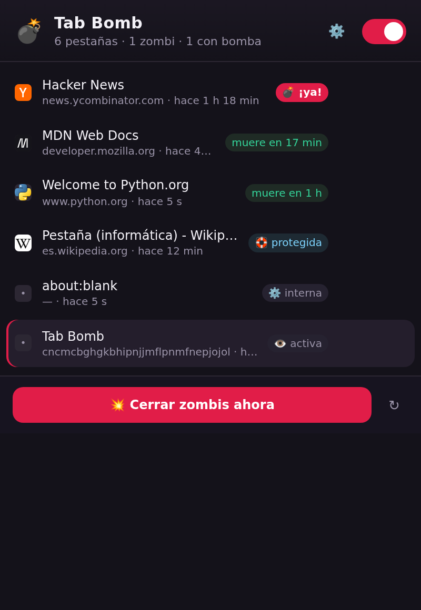

# 💣 Tab Bomb

[](https://github.com/nrocaalh/tab-bomb/actions/workflows/tests.yml)
[](LICENSE)

Extensión para **Chrome, Brave y Firefox** que cierra las pestañas que llevas demasiado tiempo sin usar.
Cada pestaña tiene un **TTL** (vida máxima sin usarse); cuando se agota, se **arma una bomba** con cuenta atrás visible y, al llegar a cero, la pestaña se cierra (o se suspende, tú eliges).

Pensada para evitar el síndrome de Diógenes digital: 40 pestañas abiertas, 38 sin tocar desde hace días.



**Descargar:** paquetes listos en [Releases](https://github.com/nrocaalh/tab-bomb/releases/latest)
(`tab-bomb-chrome.zip` · `tab-bomb-firefox.zip`) y vídeo de demostración en la misma página.

---

## Instalación

### Brave / Chrome (y Edge, Vivaldi…)

1. Descomprime `tab-bomb-chrome.zip` en una carpeta **que no vayas a mover** (por ejemplo `Documentos/TabBomb`).
   La carpeta tiene que quedar con `manifest.json`, `background.js`, `popup.html`… dentro.
2. Abre el navegador y entra en:
   - Brave → `brave://extensions`
   - Chrome → `chrome://extensions`
3. Activa **Modo de desarrollador** (interruptor arriba a la derecha).
4. Pulsa **Cargar descomprimida** y elige la carpeta `tab-bomb-chrome`.
5. Fija el icono 💣 en la barra (icono del puzzle → chincheta) para tenerlo a mano.

> Si mueves o borras esa carpeta, la extensión deja de funcionar. Para que sobreviva, guárdala en un sitio fijo.

### Firefox

Los add-ons sin firmar solo se pueden cargar en modo temporal (desaparecen al cerrar Firefox) o firmándolos. Dos opciones:

**A. Probar ahora (temporal):**
1. `about:debugging#/runtime/this-firefox`
2. **Cargar complemento temporal…**
3. Elige `manifest.json` de la carpeta `tab-bomb-firefox`.

**B. Instalación permanente:** firma el `.zip` en <https://addons.mozilla.org/developers/> con la opción *On your own* (gratis), o usa Firefox Developer Edition / Nightly con `about:config` → `xpinstall.signatures.required = false`.

Requisitos: Firefox 140+, Chrome/Brave 116+.

---

## Cómo funciona

```
pestaña sin usar ──[ TTL: 60 min ]──► 💣 BOMBA ARMADA ──[ gracia: 60 s ]──► cerrada / suspendida
                                        │
                                        ├─ badge rojo con la cuenta atrás en el icono
                                        ├─ cartel flotante dentro de la página: «se cerrará en 0:42»
                                        └─ botón «🛟 Mantener viva» para salvarla en el último segundo
```

- **TTL por defecto: 60 min.** Si no tocas una pestaña en 1 hora, empieza la cuenta atrás.
- **Cuenta atrás (bomba): 60 s.** Durante ese minuto hay aviso en el icono y en la propia página.
- **Al explotar:** por defecto **cierra** la pestaña. También puedes ponerlo en **suspender** (se queda en la barra pero libera la RAM, tipo *tab discard*).
- Se considera «uso»: activar la pestaña, cambiar de ventana a ella, o navegar en ella. Los autorefrescos en segundo plano **no** cuentan.

### Lo que nunca toca (protecciones, configurables)

- Pestañas **fijadas** 📌 y pestañas **con audio** 🔊 (música, vídeo, llamadas).
- La **pestaña activa** 👁️ y la **última pestaña de cada ventana** 🪟 (para no cerrarte la ventana entera).
- Pestañas ya **suspendidas** 💤, **agrupadas** 📁 y páginas internas (`chrome://`, `about:`, etc.).
- Las que estén en tu **lista blanca de dominios** ✅ (incluye subdominios: `google.com` cubre `mail.google.com`).
- Las que hayas marcado con **🛟 Mantener viva**.
- Todo se **pausa** mientras el equipo está inactivo o bloqueado, y al volver te da un margen (90 s) antes de matar nada.

### Acciones rápidas

- **Clic en el icono 💣** → lista de pestañas ordenada por antigüedad, con tiempo restante y botones:
  - 🛟 mantener viva (no se cierra nunca)
  - 💤 +15 minutos de prórroga
  - ✕ cerrar ahora
- **Clic derecho en una pestaña** → *Tab Bomb: mantener esta pestaña* / *cerrar esta pestaña ahora*.
- **💥 Cerrar zombis ahora** → pasa el motor una vez y cierra todo lo que ya pasó su TTL.
- **⚙️ Ajustes** → TTL, duración de la cuenta atrás, cerrar vs suspender, protecciones, lista blanca y avisos.

### Ajustes recomendados

| Situación | Ajuste |
|---|---|
| Uso normal | TTL 60 min · gracia 60 s · cerrar |
| Portátil con poca RAM | TTL 30 min · gracia 45 s · **suspender** |
| No perder nunca trabajo | Sube el TTL a 180 min y añade a la lista blanca los dominios donde escribes (docs, correo, chat, tu nube) |

> ⚠️ La extensión **no puede saber** si una pestaña tiene un formulario a medio rellenar. Si escribes en pestañas que dejas abiertas mucho rato, mételas en la lista blanca.

---

## Privacidad y permisos

Todo ocurre en tu navegador. **No hay servidor, ni cuentas, ni telemetría**; el estado se guarda en `storage.local` del propio navegador.

| Permiso | Para qué |
|---|---|
| `tabs` | ver qué pestañas hay, su título/URL y su estado (fijada, con audio…) y poder cerrarlas |
| `storage` | guardar los tiempos de uso y los ajustes |
| `alarms` | despertar el motor cada minuto (los service workers se duermen) |
| `scripting` + `host_permissions` | pintar el cartel de cuenta atrás dentro de la página |
| `idle` | pausar mientras el equipo está inactivo |
| `contextMenus` | menú del clic derecho |
| `notifications` | aviso opcional al armarse la bomba (desactivado por defecto) |

---

## Estructura del proyecto

```
tab-bomb/
├── src/                    # código fuente compartido
│   ├── background.js       # motor: TTL, bombas, protecciones, mensajes
│   ├── popup.html/.css/.js # interfaz
│   └── icons/              # 16/32/48/128 px (generados)
├── manifests/
│   ├── manifest.chrome.json    # MV3 + service_worker
│   └── manifest.firefox.json   # MV3 + background.scripts + gecko id
├── tools/gen_icons.py      # dibuja los iconos (PIL)
├── tools/zipdist.py        # empaqueta sin depender del binario `zip`
├── test/harness.js         # 46 comprobaciones del motor con navegador falso y reloj controlado
├── test/e2e.js             # 18 comprobaciones en Chromium real (cierra pestañas de verdad)
├── test/screenshot.js      # captura del popup real
├── build.sh                # → dist/tab-bomb-chrome.zip + dist/tab-bomb-firefox.zip
└── dist/                   # paquetes generados
```

### Construir y probar

```bash
./build.sh                 # regenera dist/ y los dos .zip
node test/harness.js       # motor: TTL, gracia, protecciones, persistencia, mensajes
node test/e2e.js           # Chromium real: carga la extensión y comprueba que cierra pestañas
node test/demo.js          # graba frames de la demo (popup + página con la bomba)
python3 tools/make_video.py  # monta dist/demo/tab-bomb-demo.mp4
npx web-ext lint --source-dir dist/firefox   # valida el paquete de Firefox (0 errores)
```

La lógica vive en un único `background.js`; los dos manifiestos solo cambian cómo declara el navegador
el script de fondo (`service_worker` en Chrome/Brave, `scripts` en Firefox).
